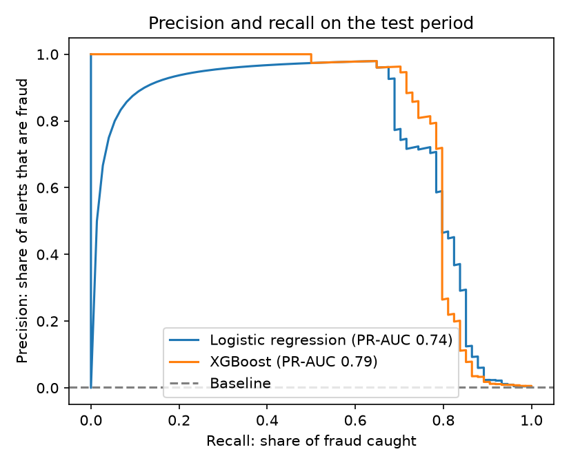
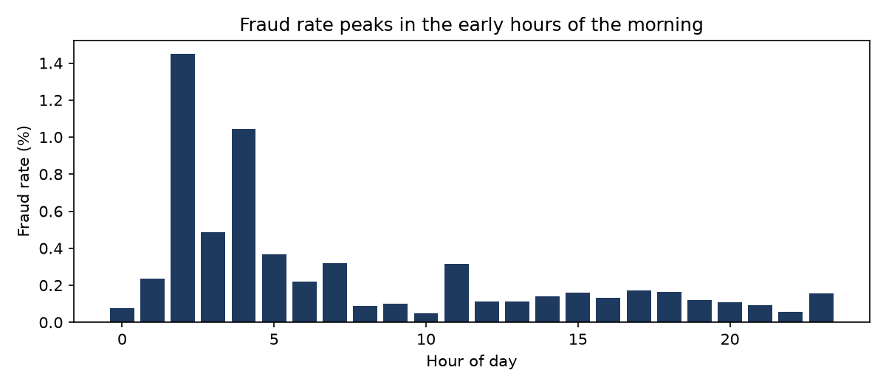
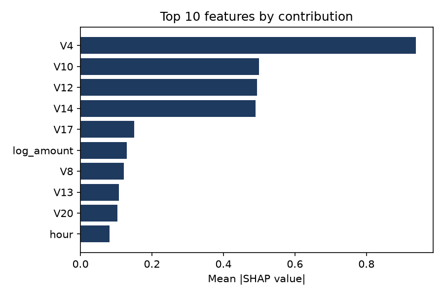

# Card fraud detection

A fraud model for card transactions, built the way a card issuer would need to run it: tested on later
transactions than it learned from, tuned to the cost of reviewing alerts, explained, and monitored for drift.

**Data:** [Credit Card Fraud Detection](https://www.openml.org/d/42397), 284,807 transactions made by
European cardholders over two days in September 2013, of which 492 are fraud (0.17%). The features V1-V28 are
anonymised PCA components. The notebook downloads the data from OpenML on its first run.

## Approach

| Step | What it does | Why |
|---|---|---|
| Cleaning | Checks for missing values and removes exact duplicate transactions | Duplicates would let copies of test rows leak into training |
| Time-based split | Oldest 60% train, next 20% validation, latest 20% test | A real fraud model only ever scores future transactions |
| Features | Hour of day, night-time flag, log of amount | Fraud rate varies by hour, and amounts are heavily skewed |
| Baselines | Always predicting the fraud rate, then logistic regression | Shows how much XGBoost actually adds |
| Model | XGBoost with early stopping on the validation period | Strong on tabular data and handles non-linear patterns |
| Metric | PR-AUC, with ROC-AUC alongside | Accuracy and ROC-AUC look good even for weak models on rare events |
| Alert threshold | Minimises review cost plus fraud value missed, chosen on validation | Turns a score into a decision a fraud team can run |
| Explainability | SHAP values from XGBoost's `pred_contribs` | Shows which features drive each prediction |
| Monitoring | Population Stability Index on the score and top features | Flags when live data no longer looks like training data |
| Scoring | `scripts/score.py` scores a CSV with the saved model and threshold | The model can be used outside the notebook |

## Results

All results are on the **test period**: the latest 20% of transactions, 56,746 of them, including 74 fraud.
The model never saw this period during training or threshold choice.

| Model | PR-AUC | ROC-AUC |
|---|---|---|
| Baseline: predict the fraud rate | 0.001 | 0.500 |
| Logistic regression | 0.744 | 0.983 |
| **XGBoost** | **0.790** | **0.983** |

Both real models have almost the same ROC-AUC, but PR-AUC shows XGBoost raises clearly fewer false alerts
for the same amount of fraud caught. That is why PR-AUC is the headline metric.



**At the alert threshold chosen on the validation period (0.68), assuming a review costs 5:**

| | Test period |
|---|---|
| Alerts raised | 52 of 56,746 transactions |
| Fraud caught | 50 of 74 cases (68%) |
| Alerts that are fraud | 96% |
| Fraud value caught | 52% |
| Cost with no model | 7,728 |
| Cost with the model | 3,989, **48% lower** |

The model catches 68% of fraud cases but only 52% of fraud value, so the cases it misses tend to be larger.
Weighting training examples by amount is the obvious next experiment.

**What drives the predictions.** Fraud is about 3.5 times more common between midnight and 6am than during
the day. In the model, the anonymised components V4, V10, V12 and V14 contribute most, and fraud cases sit far
from genuine ones on each of them.




**Monitoring.** The model's score distribution is stable between training and test (PSI 0.06). V12 crosses
the review line (PSI 0.30), which a monitoring job would raise for a person to check. Hour of day shows a very
high PSI, but that is expected: the test period covers only the last hours of day two, so drift should be
compared over like-for-like windows in production.

**Scoring script.** `scripts/score.py` reproduces the notebook exactly: it raises the same 52 alerts on the
test period.

## Project structure

```
notebooks/fraud_detection.ipynb   the full analysis
src/fraud/data.py                 loading and the time-based split
src/fraud/features.py             feature engineering
src/fraud/evaluate.py             cost, threshold choice and PSI
scripts/score.py                  batch scoring with the saved model
tests/                            pytest unit tests for the code in src/
models/                           saved model and threshold (written by the notebook)
reports/figures/                  charts (written by the notebook)
```

## Running it

```bash
python -m venv .venv
.venv\Scripts\activate            # Windows; use source .venv/bin/activate on macOS or Linux
pip install -r requirements.txt
pytest
jupyter notebook notebooks/fraud_detection.ipynb
```

Score new transactions once the notebook has saved a model:

```bash
python scripts/score.py transactions.csv scored.csv
```
